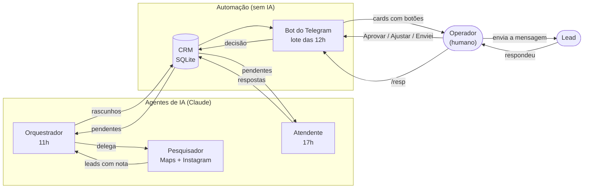

# Capta

**Captação enquanto dorme.** Um sistema de prospecção de clientes com agentes de IA,
automação e um humano no controle de tudo que sai.

> Projeto acadêmico de IA. É a versão aberta e anonimizada de um sistema que
> roda de verdade num estúdio de vídeo que atende dentistas e clínicas de harmonização em
> São Paulo. Os leads deste repositório são fictícios.

---

## O problema

Um estúdio pequeno precisa achar clientes, mas prospectar toma o dia: pesquisar
clínicas, ver quem posta vídeo, escrever uma mensagem para cada uma, lembrar de
cobrar resposta em 3 dias, responder quem voltou. Feito à mão, ou não é feito, ou
vira mensagem genérica copiada e colada, que ninguém responde.

## A solução em uma frase

**A IA pesquisa e escreve; a automação organiza e lembra; o humano aprova e envia.**



## Ver funcionando (1 minuto, sem instalar nada)

Precisa só de Python 3.10 ou mais novo.

```bash
git clone https://github.com/hmancini777/capta.git
cd capta
python demo/demo.py
```

A demo roda o fluxo inteiro com leads fictícios, sem Telegram e sem internet: os
cards aparecem no terminal. Ela passa por 8 etapas (pesquisa, revisão, ajuste,
envio, follow-up automático, resposta do lead, diagnóstico e reunião) e explica
cada uma. Use `python demo/demo.py --rapido` para rodar sem pausas.

Para conferir que a lógica está certa: `python -m unittest discover testes`.

## O que tem em cada pasta

| Pasta | O que é | Tem IA? |
|---|---|---|
| [`agentes/`](agentes/) | Os prompts de cada agente: o que faz, quando roda, o que recebe e o que devolve. | Sim |
| [`regras/`](regras/) | O "manual" que os agentes leem: quem é um bom lead, como escrever, preços, formato do diagnóstico. | É lido pela IA |
| [`capta/`](capta/) | O código: banco de dados, CRM e bot do Telegram. | Não |
| [`demo/`](demo/) | Demonstração completa com leads fictícios. | Simulada |
| [`testes/`](testes/) | Testes automáticos do fluxo. | Não |
| [`docs/`](docs/) | A explicação de cada parte, em ordem de leitura. | — |

## Leia nesta ordem

1. [Visão geral](docs/01-visao-geral.md): o problema, a solução e por que o humano fica no meio.
2. [Os agentes](docs/02-agentes.md): quem faz o quê, e por que são separados.
3. [A automação](docs/03-automacao.md): o que roda sozinho, quando e sem IA.
4. [Os dados](docs/04-dados.md): o banco, o funil e o caminho de um lead.
5. [Ética e limites](docs/05-etica-e-limites.md): o que o sistema não faz, de propósito.
6. [Como rodar de verdade](docs/06-como-rodar.md): Telegram, tarefas agendadas e o primeiro dia.
7. [Glossário](docs/glossario.md): lead, card, follow-up, CRM e os outros termos.

## Números do desenho

| | |
|---|---|
| Agentes de IA | 3 (Orquestrador, Pesquisador, Atendente) + revisão humana |
| Mensagens novas por dia | até 15 |
| Follow-ups | 2, no 3º e no 7º dia, cancelados sozinhos se o lead responder |
| Mensagens enviadas sem aprovação humana | 0 |
| Dependências externas do código | 0 (só a biblioteca padrão do Python) |
