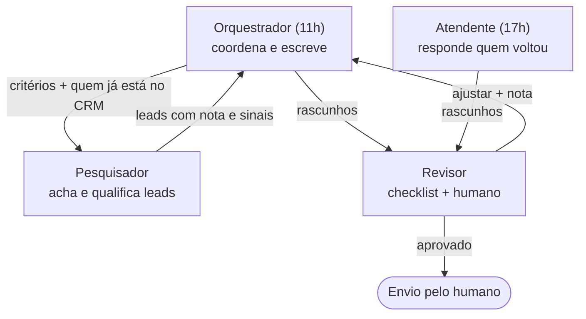

# 2. Os agentes

Um **agente** aqui é um modelo de linguagem (Claude) que recebe um objetivo, um
conjunto de regras e ferramentas (navegador, terminal, agenda), e decide sozinho os
passos para chegar lá. Diferente de um chatbot, ele não espera uma pergunta por vez:
roda a tarefa inteira e devolve o resultado.

O Capta usa o padrão **orquestrador + especialistas + revisor**.

## Quem faz o quê

| Agente | Quando | Recebe | Entrega | Prompt |
|---|---|---|---|---|
| **Orquestrador** | Dias úteis, 11h | `crm.py pendentes`, recados, notas de ajuste, regras | 1ªs mensagens e follow-ups no CRM | [orquestrador-11h.md](../agentes/orquestrador-11h.md) |
| **Pesquisador** | Chamado pelo Orquestrador | Critérios + lista de quem já está no CRM | Leads com nota de 0 a 10, sinais e o Reel a citar | [pesquisador.md](../agentes/pesquisador.md) |
| **Atendente** | Seg a sáb, 17h | Leads que responderam, com a conversa inteira | Resposta, diagnóstico ou convite de reunião | [atendente-17h.md](../agentes/atendente-17h.md) |
| **Revisor** | Antes de cada card | O texto escrito | Aprovado, reescrito ou descartado | [revisor.md](../agentes/revisor.md) |

## Por que vários agentes e não um só

- **Foco:** um prompt curto e específico erra menos que um prompt enorme que faz tudo.
- **Custo:** o Pesquisador abre dezenas de páginas. Ele roda num modelo mais barato e
  devolve só um resumo; o modelo principal fica com a escrita, que é onde a qualidade importa.
- **Horários diferentes:** prospectar pode esperar o dia seguinte; responder um lead
  quente, não. O Atendente roda à tarde só para isso.
- **Contexto limpo:** o Orquestrador não precisa ver o HTML de 40 perfis, só a lista final.

## Como os agentes "lembram" das coisas

Modelos de linguagem não guardam memória entre uma rodada e outra. A memória do
sistema fica fora deles:

| Memória | Onde | Para quê |
|---|---|---|
| Quem já foi contatado, em que etapa está | Banco SQLite (`crm.py`) | Não repetir contato, saber o que vence hoje |
| Como escrever | `regras/estilo-escrita.md` | Cada correção do operador vira regra |
| Quem é um bom lead | `regras/criterios-lead.md` | Critérios objetivos e pontuação |
| O que vender e por quanto | `regras/ofertas.md` | O agente nunca inventa preço |

No começo de cada rodada, o agente roda `crm.py pendentes` e recebe um JSON com
a "pauta" do dia. É como um funcionário que chega e lê o quadro de tarefas.

## Como os agentes rodam

Os agentes rodam como **tarefas agendadas do Claude Code** (a ferramenta de linha de
comando da Anthropic). Cada tarefa tem um horário (cron) e um prompt, que é o arquivo
correspondente em `agentes/`. O Claude Code dá ao agente acesso ao terminal (para
chamar `crm.py`), ao navegador (para o Maps e o Instagram) e à agenda.
