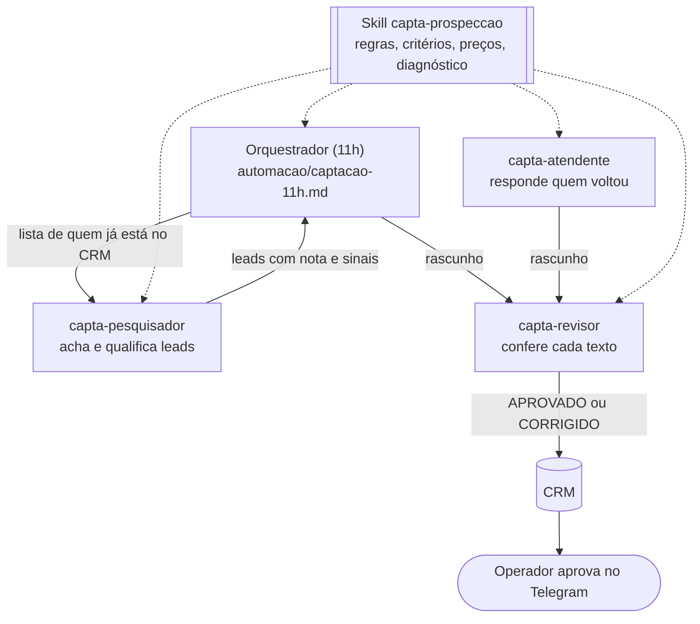

# 2. A skill e os agentes

O Capta usa o padrão **orquestrador + especialistas + revisor**, todo montado com o
Claude Code: uma **skill** com o conhecimento do negócio, **subagentes** com papéis
separados e um **orquestrador** que coordena tudo no horário.

## A skill: `capta-prospeccao`

**O que é uma skill:** um pacote que ensina o Claude a fazer um tipo de trabalho. É uma
pasta com um `SKILL.md` (as instruções e quando usar) e materiais de referência. O
Claude lê a descrição da skill e a carrega sozinho quando a tarefa pede.

| Arquivo | Conteúdo |
|---|---|
| [`SKILL.md`](../.claude/skills/capta-prospeccao/SKILL.md) | Quando usar, o que fazer em cada situação, modelo da 1ª mensagem, checklist, como gravar no CRM |
| [`referencias/criterios-lead.md`](../.claude/skills/capta-prospeccao/referencias/criterios-lead.md) | Quem é um bom lead: obrigatórios, eliminatórios e tabela de pontos (0 a 10) |
| [`referencias/estilo-escrita.md`](../.claude/skills/capta-prospeccao/referencias/estilo-escrita.md) | Como escrever. Este arquivo aprende: cada correção do operador entra no fim |
| [`referencias/ofertas.md`](../.claude/skills/capta-prospeccao/referencias/ofertas.md) | Pacotes e preços. O agente nunca inventa condição fora daqui |
| [`referencias/diagnostico.md`](../.claude/skills/capta-prospeccao/referencias/diagnostico.md) | A isca: diagnóstico grátis do perfil (3 travas e 3 roteiros), com as regras do CFO |

**Por que skill e não um prompt gigante:** o conhecimento fica num lugar só e todos os
agentes usam a mesma versão. Quando o operador corrige o estilo, a correção vale para
o orquestrador, o atendente e o revisor ao mesmo tempo. E a skill funciona fora do
Capta: dá para usar no Claude.ai ou em qualquer projeto do Claude Code.

## Os agentes

**O que é um agente:** um modelo de linguagem que recebe um objetivo, regras e
ferramentas (terminal, navegador, agenda) e decide sozinho os passos até terminar.
No Claude Code, um **subagente** é um arquivo em `.claude/agents/` com nome, descrição,
modelo, ferramentas e o prompt. O orquestrador chama cada um pelo nome.

| Agente | Arquivo | Modelo | Recebe | Entrega |
|---|---|---|---|---|
| **Orquestrador** | [`automacao/captacao-11h.md`](../automacao/captacao-11h.md) | principal | `crm.py pendentes`, recados, notas de ajuste | 1ªs mensagens e follow-ups no CRM |
| **Pesquisador** | [`capta-pesquisador.md`](../.claude/agents/capta-pesquisador.md) | Sonnet | Critérios + quem já está no CRM | Leads com nota, sinais e o Reel a citar (JSON) |
| **Atendente** | [`capta-atendente.md`](../.claude/agents/capta-atendente.md) | principal | Leads que responderam, com a conversa inteira | Resposta, diagnóstico ou convite de reunião |
| **Revisor** | [`capta-revisor.md`](../.claude/agents/capta-revisor.md) | Sonnet, só leitura | Um texto | `APROVADO` ou `CORRIGIDO` com as regras quebradas |

## Por que vários agentes e não um só

- **Foco:** um prompt curto e específico erra menos que um prompt enorme que faz tudo.
- **Custo:** o Pesquisador abre dezenas de páginas. Ele roda num modelo mais barato e
  devolve só um resumo; o modelo principal fica com a escrita, que é onde a qualidade importa.
- **Contexto limpo:** o orquestrador não vê o HTML de 40 perfis, só a lista final.
- **Revisão independente:** quem escreve não revisa o próprio texto. O Revisor só tem
  permissão de leitura e não sabe o que o autor "quis dizer", só o que está escrito.
- **Horários diferentes:** prospectar pode esperar o dia seguinte; responder um lead
  quente, não. O Atendente também roda às 17h, só para isso.

## Como os agentes "lembram" das coisas

Os modelos não guardam memória entre uma rodada e outra. A memória do sistema fica fora deles:

| Memória | Onde | Para quê |
|---|---|---|
| Quem já foi contatado e em que etapa está | Banco SQLite (via `crm.py`) | Não repetir contato, saber o que vence hoje |
| Como escrever | `estilo-escrita.md` da skill | Cada correção do operador vira regra |
| O que fazer hoje | `crm.py pendentes` | A pauta da rodada, em JSON |

No começo de cada rodada, o orquestrador roda `crm.py pendentes`. É como um
funcionário que chega e lê o quadro de tarefas antes de começar.
