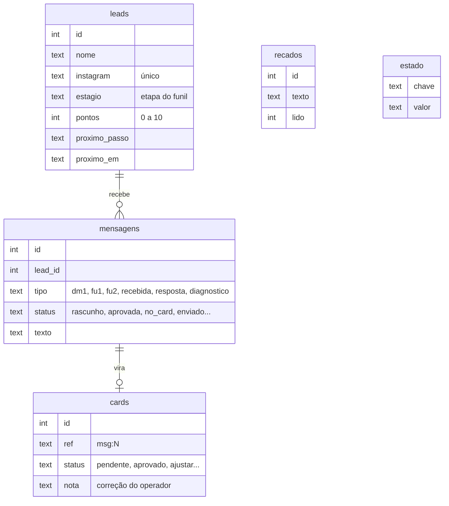
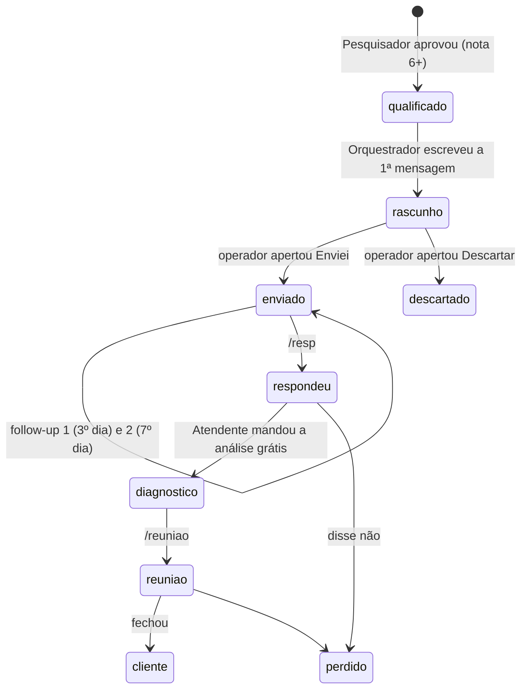

# 4. Os dados

Tudo fica num único arquivo SQLite (`dados/capta.sqlite`), criado sozinho na
primeira execução. O desenho completo, comentado linha a linha, está em
[`capta/esquema.sql`](../capta/esquema.sql).

## As tabelas

| Tabela | Guarda | Quem escreve |
|---|---|---|
| `leads` | Cada potencial cliente e a etapa do funil | Agentes (via `crm.py`) e botões |
| `mensagens` | Cada texto escrito para um lead e o que o lead respondeu | Agentes e `/resp` |
| `cards` | Cada card mandado ao Telegram e o botão apertado | Bot |
| `recados` | Instruções livres do operador | Bot |
| `estado` | Modo atual, data do último lote, posição de leitura do Telegram | Bot |

## O caminho de um lead (funil)

## O caminho de uma mensagem

| Status | Significa |
|---|---|
| `rascunho` | A IA escreveu, ainda não foi para o Telegram |
| `no_card` | Está num card, esperando o operador |
| `aprovada` | Aprovada na revisão; sai no próximo lote de envio |
| `ajustar` | O operador pediu mudança; o agente reescreve na próxima rodada |
| `refeita` | Versão antiga, substituída pela reescrita (fica para histórico) |
| `enviado` | O operador enviou de verdade |
| `descartado` | Não vai sair |
| `recebida` | Não é nossa: é o que o lead respondeu |

## A interface entre IA e dados

Os agentes não escrevem SQL. Eles chamam comandos do `crm.py`, que validam e
limpam o que chega:

| Comando | Para quê |
|---|---|
| `pendentes` | A pauta da rodada, em JSON |
| `novos-leads <json>` | Grava leads novos (recusa duplicados) |
| `mensagem <json>` | Grava uma mensagem para um lead existente |
| `atualizar-lead <json>` | Completa ou descarta um lead |
| `respostas` | Manda na hora os cards de lead que respondeu |
| `resumo` | O funil em números |

Assim, se a IA mandar `@Dra.Camila` ou `instagram.com/dra.camila/`, o CRM entende
as duas como `dra.camila` e não deixa a mesma pessoa entrar duas vezes.
